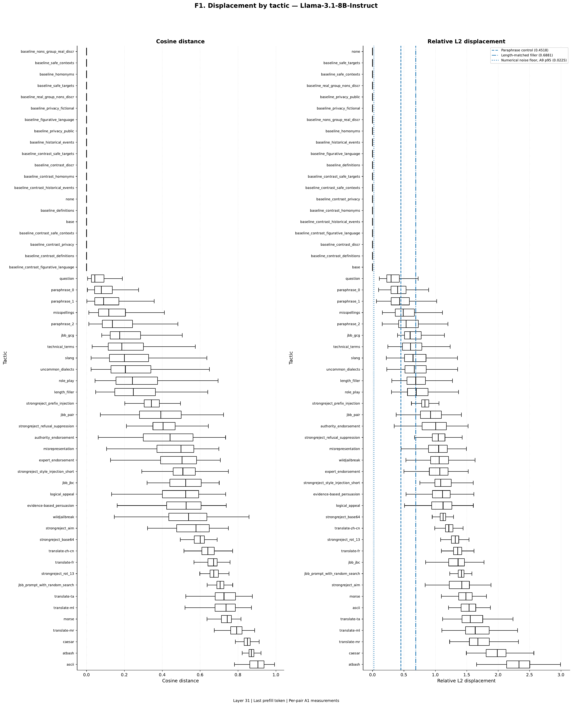
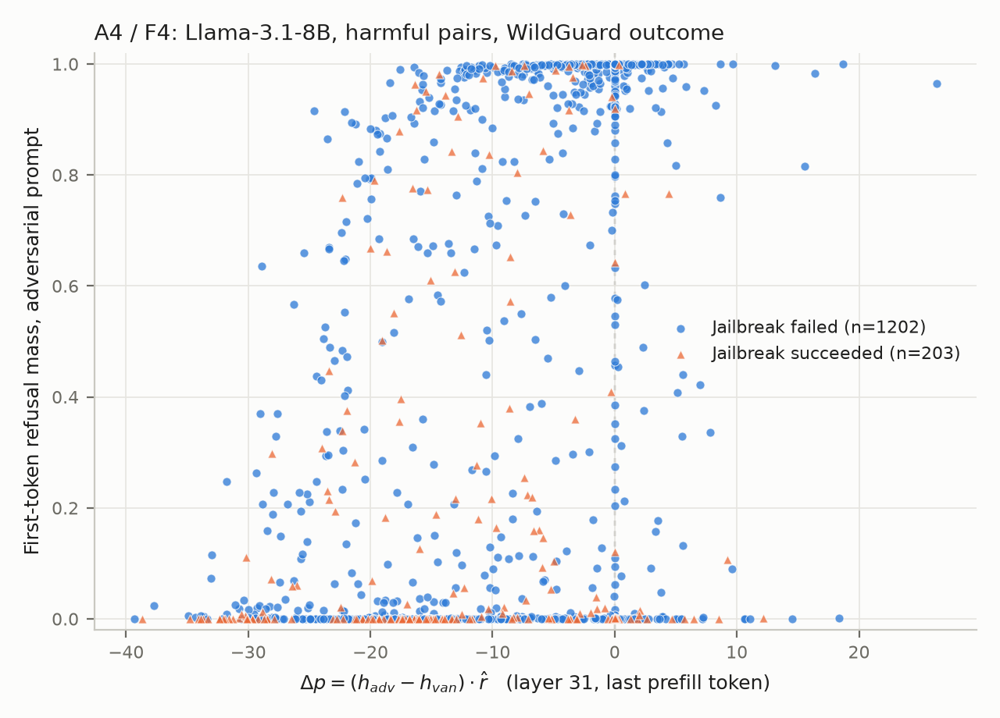
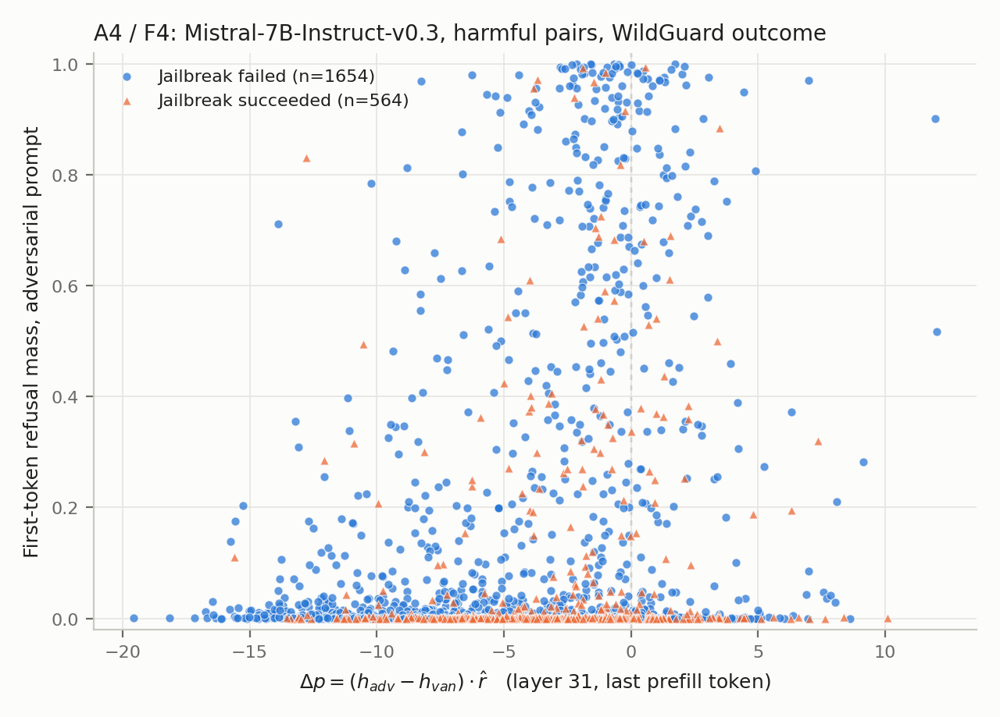
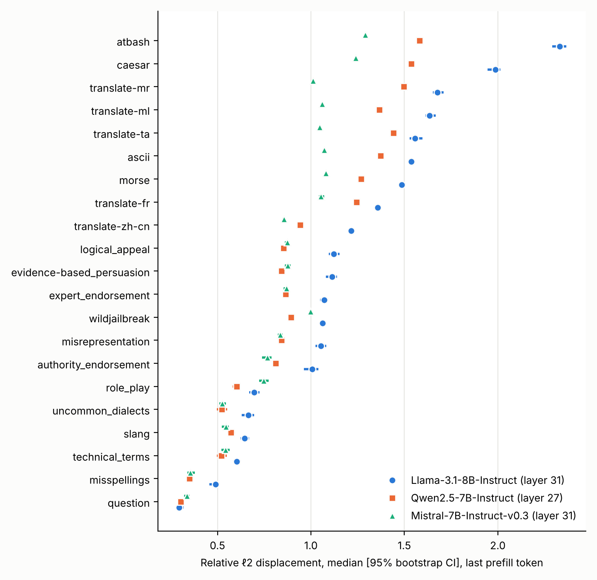

# Numerical Results (WS2)

Unless stated otherwise:
- Values are medians with 95% bootstrap intervals (2,000 resamples, seed 0).
- Displacement is measured between a vanilla prompt (h_van) and its adversarial pair (h_adv) as relative ℓ2 = ‖h_adv − h_van‖ / ‖h_van‖, sometimes with cosine distance.
- The configuration for Llama-3.1-8B-Instruct is C1: HF backend, bf16, batch 1, A100-40GB, Undercurrent 0.1.0.

Sections 1–5 are main results (F1 is Figure 1; F4 is Figures 2 and 3). Sections 6–8 are appendix results.

---

## 1. Noise floor (A9)

On 32 prompts (1,536 activations), two bf16 runs on identical input gave identical activations. Between bf16 and fp32, relative ℓ2 had a median of 0.0109, a 95th percentile of 0.0225 and a maximum of 0.0405 (Table 1). The 95th percentile, 0.0225, is the noise floor used for SNR and drawn on F1.

**Table 1.** bf16 vs fp32, Llama-3.1-8B-Instruct, 1,536 activations.

| Comparison | Cosine distance, median | Cosine distance, p95 | Relative ℓ2, median | Relative ℓ2, p95 | Relative ℓ2, max |
|---|---|---|---|---|---|
| bf16 vs bf16 (repeat) | 0 | 0 | 0 | 0 | 0 |
| bf16 vs fp32 | 5.84 × 10⁻⁵ | 2.54 × 10⁻⁴ | 0.01091 | 0.02253 | 0.04046 |

The HF-vs-vLLM and concurrency floors were not measured.

---

## 2. Displacement per tactic (A1, F1)

**Groups.** Of 56 groups, 21 have identical vanilla and adversarial text, so their displacement is zero by construction. That leaves 31 adversarial tactic groups and 4 control groups.

**Baselines.**
- Paraphrase (n = 1,499): 0.4518 [0.4409, 0.4656].
- Length-matched filler (n = 500): 0.6881 [0.6683, 0.7336].

**Tactics.** The largest displacement was SORRY-Bench atbash: 2.3313 [2.2908, 2.3667]. That is 103 times the noise floor and 5.2 times the paraphrase baseline. All twelve tactics in Table 2 exceed 1.30. Across the 31 tactic groups:
- 29 have a lower bound above the paraphrase upper bound (0.4656).
- 24 have a lower bound above the length-filler upper bound (0.7336).
- One group, question (0.2952 [0.2853, 0.3183]), has a median below the paraphrase baseline.
- Six groups have medians below the length-filler baseline: question, misspellings, jbb_gcg, technical_terms, slang and uncommon_dialects.

All 35 non-degenerate groups are in Table A1.

**Table 2.** A1 controls and the twelve largest tactic groups, Llama-3.1-8B-Instruct, layer 31, last prefill token. SNR = median / 0.0225.

| Group | Source | n | Relative ℓ2 [95% CI] | SNR |
|---|---|---|---|---|
| Paraphrase (control) | — | 1,499 | 0.4518 [0.4409, 0.4656] | — |
| Length-matched filler (control) | — | 500 | 0.6881 [0.6683, 0.7336] | 30.5 |
| Noise floor (A9, p95) | — | 1,536 | 0.0225 | 1.0 |
| atbash | SORRY-Bench | 440 | 2.3313 [2.2908, 2.3667] | 103.5 |
| caesar | SORRY-Bench | 440 | 1.9862 [1.9442, 2.0137] | 88.2 |
| translate-mr | SORRY-Bench | 440 | 1.6770 [1.6522, 1.7097] | 74.4 |
| translate-ml | SORRY-Bench | 440 | 1.6349 [1.6114, 1.6676] | 72.6 |
| translate-ta | SORRY-Bench | 440 | 1.5572 [1.5273, 1.5959] | 69.1 |
| ascii | SORRY-Bench | 440 | 1.5371 [1.5199, 1.5524] | 68.2 |
| morse | SORRY-Bench | 440 | 1.4856 [1.4690, 1.5074] | 65.9 |
| strongreject_aim | StrongREJECT | 313 | 1.4201 [1.3971, 1.4458] | 63.0 |
| jbb_prompt_with_random_search | JailbreakBench | 113 | 1.4165 [1.3998, 1.4294] | 62.9 |
| jbb_jbc | JailbreakBench | 100 | 1.3620 [1.3043, 1.3946] | 60.5 |
| translate-fr | SORRY-Bench | 440 | 1.3563 [1.3436, 1.3648] | 60.2 |
| strongreject_rot_13 | StrongREJECT | 313 | 1.3180 [1.3026, 1.3329] | 58.5 |

**Figure 1 (F1).** Displacement per group, Llama-3.1-8B-Instruct, layer 31, last prefill token. Left: cosine distance. Right: relative ℓ2. Boxes show the interquartile range of per-pair values, with the median marked. The reference lines are the paraphrase baseline (0.4518, dashed), the length filler (0.6881, dash-dot) and the noise floor (0.0225, dotted). All 56 groups are shown, including the 21 at zero.

In Figure 1, the noise floor is below the lower quartile of every non-degenerate group. Most groups also have their whole box above the paraphrase baseline. Ranking by cosine distance is close to ranking by relative ℓ2, but not identical: ascii has the largest cosine distance (0.905) and is sixth by relative ℓ2.

**H6 (displacement ≥ 10 × the noise floor, i.e. ≥ 0.225).** All 31 tactic groups on Llama have a lower bound above 0.225. The lowest is question (lower bound 0.2853, SNR 13.1). No p-value was computed. H6 cannot be tested on Qwen or Mistral because neither has a noise floor.

---

## 3. Judge agreement

Both judges parsed every reply. On the 2,000 replies labelled by both, WildGuard (harmful response) and Llama Guard 3 (unsafe) agreed on 92.4%, with κ = 0.589 [0.527, 0.647] (Table 3). WildGuard flagged 9.8% and Llama Guard 3 flagged 10.8%. Both flagged 130 replies, both passed 1,718, and they disagreed on 152 (65 flagged by WildGuard only, 87 by Llama Guard 3 only). Over all 2,742 replies, WildGuard labelled 9.7% as harmful and 50.5% as refusals.

**Table 3.** Judge agreement, Llama-3.1-8B-Instruct replies.

| Judge pair | n | Agreement | Cohen's κ [95% CI] |
|---|---|---|---|
| WildGuard (harmful response) vs Llama Guard 3 (unsafe) | 2,000 | 92.4% | 0.589 [0.527, 0.647] |

---

## 4. Shift and jailbreak success (A4, F4): Llama-3.1-8B-Instruct

**Direction and sample.** The harmfulness direction separated 1,314 held-out vanilla prompts by intent with AUROC 0.981 [0.975, 0.987]. Of 1,405 harmful pairs, 203 (14.4%) were successful jailbreaks and 1,202 failed. The offline first-token prediction matched the stored reply's first token for 99.2% of prompts (2,719 of 2,742).

**Table 4.** Δp and refusal mass by outcome, Llama-3.1-8B-Instruct, layer 31, last prefill token.

| Outcome | n | Δp [95% CI] | Refusal mass [95% CI] |
|---|---|---|---|
| Succeeded | 203 | −14.1527 [−15.5003, −12.3592] | 0.0033 [0.0006, 0.0197] |
| Failed | 1,202 | −2.0456 [−2.9255, −1.4720] | 0.9586 [0.9253, 0.9770] |
| Difference (succeeded − failed) | — | −12.1072 [−13.6806, −10.0008] | −0.9553 [−0.9746, −0.9200] |

**Predicting success.** AUROC was 0.298 [0.260, 0.339] for Δp and 0.251 [0.225, 0.279] for refusal mass. Both are below 0.5 because lower values go with success; read as "lower predicts success", they are about 0.70 and 0.75. In a joint logistic fit (intercept −2.157):
- Δp: −0.276 [−0.446, −0.112] per SD (odds ratio 0.76).
- Refusal mass: −0.872 [−1.078, −0.668] per SD (odds ratio 0.42).

Both intervals exclude zero.

**H2** (successful jailbreaks have a larger drop in Δp): observed on Llama. The difference is −12.11, and its interval excludes zero.

**Figure 2 (F4).** Δp against first-token refusal mass, Llama-3.1-8B-Instruct, layer 31, last prefill token, harmful pairs. Circles: failed (n = 1,202). Triangles: succeeded (n = 203). Dashed line: Δp = 0.

In Figure 2, Δp runs from about −40 to +26, and refusal mass sits mostly near 0 or near 1. Successful jailbreaks are mostly at refusal mass near 0 with negative Δp. Failed jailbreaks appear in both bands, so the two outcomes overlap near 0.

---

## 5. Replication on Qwen and Mistral (A1, A4, A6)

### 5.1 Qwen2.5-7B-Instruct

Configuration: Undercurrent 0.1.0, HF backend, bf16, batch 1, 16,515 pairs, last layer 27.

**A1.** 21 of 56 groups are degenerate, leaving 31 tactic groups.
- Baselines: paraphrase 0.3810 [0.3707, 0.3925] (n = 1,499); length filler 0.3265 [0.3141, 0.3394] (n = 500). On Qwen the filler baseline is below the paraphrase baseline.
- All pairs pooled, layer 27: 0.8539 [0.8483, 0.8599].
- Largest tactics: atbash 1.5805 [1.5670, 1.5889], caesar 1.5374 [1.5303, 1.5514], translate-mr 1.4980 [1.4853, 1.5088].
- 29 of 31 tactic groups have a lower bound above both baselines.
- misspellings (0.3496) and question (0.3026) are below the paraphrase baseline; question is also below the filler baseline.

The tactic ranking matches Llama closely (Spearman ρ = 0.930, n = 31, p = 4.0 × 10⁻¹⁴).

**A6.** At the last prefill token, displacement rises from 0.2228 at layer 1 to 0.8539 at layer 27 (Table 5). At the last instruction token it stays between 0.5002 and 0.7974. The last instruction token is larger at layers 1–21 and the last prefill token is larger at layers 23–27. The intervals of the two positions are disjoint at all 14 shared layers.

**Table 5.** A6 position split, Qwen2.5-7B-Instruct (16,515 pairs per cell), 7 of 14 shared layers.

| Layer | Last prefill [95% CI] | Last instruction [95% CI] |
|---|---|---|
| 1 | 0.2228 [0.2215, 0.2247] | 0.5002 [0.4947, 0.5055] |
| 7 | 0.4341 [0.4320, 0.4358] | 0.7974 [0.7927, 0.8019] |
| 13 | 0.4073 [0.4052, 0.4097] | 0.6937 [0.6882, 0.6988] |
| 19 | 0.5644 [0.5579, 0.5711] | 0.7114 [0.7051, 0.7161] |
| 21 | 0.6562 [0.6484, 0.6634] | 0.7072 [0.7035, 0.7116] |
| 23 | 0.7127 [0.7053, 0.7186] | 0.6993 [0.6946, 0.7034] |
| 27 | 0.8539 [0.8483, 0.8599] | 0.7611 [0.7562, 0.7658] |

A4 was not run on Qwen.

### 5.2 Mistral-7B-Instruct-v0.3: A1

Configuration: HF backend, bf16, batch 1, L40S; layer 31, last prefill token. Harvest: SORRY-Bench and WildJailbreak only. There are no paraphrase or length controls, so no baselines.

**Groups.** 10,796 pairs in 21 tactic groups, none degenerate.

**By source.**
- SORRY-Bench (n = 8,796): 0.9032 [0.8963, 0.9098].
- WildJailbreak (n = 2,000): 0.9968 [0.9890, 1.0049].

**By tactic.**
- Largest: atbash 1.2905 [1.2874, 1.2976] and caesar 1.2405 [1.2338, 1.2477].
- Smallest: misspellings 0.3551 [0.3386, 0.3783] and question 0.3365 [0.3208, 0.3501].

The tactic ranking matches Llama closely (Spearman ρ = 0.939 [0.802, 0.984], n = 21, p = 3.0 × 10⁻¹⁰).

**Table 6.** A1, Mistral-7B-Instruct-v0.3, layer 31, last prefill token, with the Llama median for the same group.

| Tactic | Source | n | Mistral [95% CI] | Llama |
|---|---|---|---|---|
| atbash | SORRY-Bench | 440 | 1.2905 [1.2874, 1.2976] | 2.3313 |
| caesar | SORRY-Bench | 440 | 1.2405 [1.2338, 1.2477] | 1.9862 |
| morse | SORRY-Bench | 440 | 1.0797 [1.0762, 1.0844] | 1.4856 |
| ascii | SORRY-Bench | 440 | 1.0701 [1.0670, 1.0737] | 1.5371 |
| translate-ml | SORRY-Bench | 440 | 1.0602 [1.0538, 1.0649] | 1.6349 |
| translate-fr | SORRY-Bench | 440 | 1.0523 [1.0418, 1.0706] | 1.3563 |
| translate-ta | SORRY-Bench | 440 | 1.0465 [1.0395, 1.0519] | 1.5572 |
| translate-mr | SORRY-Bench | 440 | 1.0117 [1.0067, 1.0188] | 1.6770 |
| wildjailbreak | WildJailbreak | 2,000 | 0.9968 [0.9890, 1.0049] | 1.0613 |
| evidence-based_persuasion | SORRY-Bench | 440 | 0.8757 [0.8606, 0.8922] | 1.1143 |
| logical_appeal | SORRY-Bench | 440 | 0.8732 [0.8601, 0.8850] | 1.1227 |
| expert_endorsement | SORRY-Bench | 440 | 0.8697 [0.8531, 0.8788] | 1.0711 |
| translate-zh-cn | SORRY-Bench | 440 | 0.8552 [0.8473, 0.8616] | 1.2144 |
| misrepresentation | SORRY-Bench | 440 | 0.8364 [0.8235, 0.8502] | 1.0529 |
| authority_endorsement | SORRY-Bench | 440 | 0.7683 [0.7386, 0.7905] | 1.0066 |
| role_play | SORRY-Bench | 440 | 0.7462 [0.7233, 0.7730] | 0.6955 |
| slang | SORRY-Bench | 440 | 0.5446 [0.5230, 0.5611] | 0.6447 |
| technical_terms | SORRY-Bench | 440 | 0.5441 [0.5221, 0.5648] | 0.6040 |
| uncommon_dialects | SORRY-Bench | 440 | 0.5256 [0.5091, 0.5464] | 0.6650 |
| misspellings | SORRY-Bench | 440 | 0.3551 [0.3386, 0.3783] | 0.4896 |
| question | SORRY-Bench | 436 | 0.3365 [0.3208, 0.3501] | 0.2952 |

### 5.3 Mistral-7B-Instruct-v0.3: A4 (F4)

Configuration: activations from the HF bf16 harvest; replies and WildGuard labels from vLLM bf16 on a 4,000-prompt subset.

**Direction and sample.**
- The harmfulness direction (fitted on 484 harmful and 510 benign vanilla prompts) separated 1,030 held-out vanilla prompts with AUROC 0.975 [0.966, 0.983].
- Of 2,218 harmful pairs, 564 (25.4%) were successful jailbreaks and 1,654 failed.
- 462 harmful pairs flagged as possibly not understood were excluded.
- The offline first-token prediction matched the stored reply for 97.97% of 3,999 prompts.
- About 85% of replies reached the 256-token limit.

**Table 7.** Δp and refusal mass by outcome, Mistral-7B-Instruct-v0.3, layer 31, last prefill token. Refusal tokens: "I", "Sorry".

| Outcome | n | Δp [95% CI] | Refusal mass [95% CI] |
|---|---|---|---|
| Succeeded | 564 | −3.0391 [−3.4254, −2.5067] | 0.00016 [0.00008, 0.00032] |
| Failed | 1,654 | −4.9927 [−5.3674, −4.6608] | 0.00260 [0.00192, 0.00341] |
| Difference (succeeded − failed) | — | +1.9537 [+1.4845, +2.5798] | −0.00244 [−0.00329, −0.00173] |

**Predicting success** ("higher predicts success"). AUROC was 0.619 [0.593, 0.643] for Δp and 0.365 [0.340, 0.394] for refusal mass. In a joint logistic fit (intercept −1.166):
- Δp: +0.544 [0.445, 0.645] per SD (odds ratio 1.72).
- Refusal mass: −0.479 [−0.615, −0.355] per SD (odds ratio 0.62).

**H2** is not observed on Mistral: successful jailbreaks had a smaller drop in Δp than failed ones (+1.95, interval excludes zero). This is the opposite of Llama.

**Table 8.** Mistral A4 by subset.

| Subset | n (succeeded / failed) | Δp difference [95% CI] | AUROC Δp [95% CI] | AUROC refusal mass [95% CI] |
|---|---|---|---|---|
| SORRY-Bench | 1,922 (441 / 1,481) | +2.598 [+1.932, +3.246] | 0.646 [0.619, 0.673] | 0.378 [0.348, 0.408] |
| WildJailbreak | 296 (123 / 173) | −0.462 [−1.602, +1.101] | 0.461 [0.395, 0.526] | 0.409 [0.345, 0.475] |
| Replies not truncated | 180 (35 / 145) | −0.330 [−1.790, +1.493] | 0.491 [0.387, 0.605] | 0.267 [0.189, 0.355] |
| Extra refusal tokens ("Unfortunately", "As") | 2,218 (564 / 1,654) | +1.954 [+1.485, +2.580] | 0.619 [0.593, 0.643] | 0.416 [0.389, 0.445] |
| Outcome = WildGuard "complied" | 2,218 (1,927 / 291) | −1.744 [−2.525, −0.618] | 0.415 [0.385, 0.448] | 0.299 [0.265, 0.334] |

The positive Δp difference comes from SORRY-Bench. For WildJailbreak and for non-truncated replies, the interval includes zero. With "complied" as the outcome, the difference is negative. On 296 benign pairs, Δp was +6.717 [6.201, 7.149]. Mistral refused none of the 296 benign adversarial prompts, so the benign check cannot be made.

**Figure 3 (F4, Mistral).** Δp against first-token refusal mass, Mistral-7B-Instruct-v0.3, layer 31, last prefill token, harmful pairs. Circles: failed (n = 1,654). Triangles: succeeded (n = 564). Axes as in Figure 2.

In Figure 3, Δp spans about −20 to +12, narrower than on Llama. Most pairs in both outcomes have refusal mass near 0, and fewer failed pairs sit near 1 than on Llama. The two outcomes overlap across the Δp range.

### 5.4 Across models

**Figure 4.** Per-tactic relative ℓ2 (median, 95% CI) at the last prefill token of each model's last layer, for the 21 tactic groups present in all three harvests. Rows are ordered by the Llama median.

Figure 4 shows that the tactic order is similar across models (ρ = 0.930 Qwen–Llama, 0.939 Mistral–Llama), while the sizes differ. Llama has the largest values for the cipher and translation tactics, for example atbash at 2.33, against 1.58 for Qwen and 1.29 for Mistral. The three models are close for the smallest tactics; question is 0.295, 0.303 and 0.337. Relative ℓ2 depends on each model's activation scale, so sizes are compared within a model, not across models.

Gemma-2-9B-it was not analysed in WS2.

### 5.5 Mistral-7B-Instruct-v0.3: A6

Configuration: re-captured with HF transformers, bf16, batch 1; up to 30 pairs per tactic group (seed 0); all 32 layers at the last prefill and last instruction tokens.

*(Results from `a6_layer_sweep_mistral-7b.csv`, `a6_position_split_mistral-7b.csv` and `a6_mistral-7b_meta.json` go here once the re-run is finished. Report: pairs measured and dropped; the layer-31 check against the harvest (mean and minimum cosine); the last-prefill and last-instruction values at layer 31 and the peak layer of each; the layers where each position is larger; and the number of layers with disjoint intervals.)*

**Table 9.** A6 position split, Mistral-7B-Instruct-v0.3 (to be filled from `a6_position_split_mistral-7b.csv`).

| Layer | Last prefill [95% CI] | Last instruction [95% CI] |
|---|---|---|
| 0 | | |
| 4 | | |
| 8 | | |
| 12 | | |
| 16 | | |
| 20 | | |
| 24 | | |
| 28 | | |
| 31 | | |

**Figure 5.** A6 layer sweep, Mistral-7B-Instruct-v0.3 (`a6_layer_sweep_mistral-7b.png`, to be added).

---

## 6. Appendix: layer sweep and position split on Llama (A6)

SNR ranged from 21.4 to 45.5 across all 48 layer-position cells. At layer 31, last prefill token, displacement was 1.0261 [1.0139, 1.0373] (SNR 45.5).

At the last instruction token, displacement is already high at layer 1 (about 0.80–0.96 throughout). At the last prefill token it starts lower (about 0.49–0.53) and grows with depth. The last instruction token is larger at layers 1–21; the last prefill token is larger at layers 25–31. The two positions' intervals are disjoint at 15 of 16 shared layers. The exception is layer 23: 0.9048 [0.8965, 0.9115] vs 0.8914 [0.8856, 0.8979].

**Table 10.** A6 position split, Llama-3.1-8B-Instruct, 7 of 16 shared layers (all layers: `a6_layer_sweep_llama31-8b_snr.csv`).

| Layer | Last prefill [95% CI] | Last instruction [95% CI] |
|---|---|---|
| 1 | 0.5250 [0.5197, 0.5308] | 0.8046 [0.7987, 0.8096] |
| 5 | 0.4854 [0.4815, 0.4891] | 0.9149 [0.9089, 0.9207] |
| 11 | 0.6019 [0.5964, 0.6081] | 0.9625 [0.9563, 0.9686] |
| 17 | 0.7743 [0.7667, 0.7814] | 0.8858 [0.8776, 0.8937] |
| 23 | 0.9048 [0.8965, 0.9115] | 0.8914 [0.8856, 0.8979] |
| 27 | 0.9168 [0.9089, 0.9239] | 0.8939 [0.8886, 0.8987] |
| 31 | 1.0261 [1.0139, 1.0373] | 0.9167 [0.9121, 0.9213] |

---

## 7. Appendix: drift under serving changes (X4)

500 prompts, layer 31, last prefill token, each configuration compared with C1.

**Table 11.** Drift from C1, Llama-3.1-8B-Instruct.

| Config | Relative ℓ2 [95% CI] | Cosine distance [95% CI] | Linear CKA | Share of A1 displacement (1.026) |
|---|---|---|---|---|
| C3 (fp16) | 0.0198 [0.0190, 0.0207] | 0.0002 [0.0002, 0.0002] | 0.9999 | 1.9% |
| C6 (4-bit NF4) | 0.3438 [0.3329, 0.3601] | 0.0597 [0.0561, 0.0654] | 0.9759 | 33.5% |
| C2, C5, C7 | not run | not run | not run | — |

fp16 drift (0.0198) is about the size of the noise floor (0.0225). NF4 drift is about 17 times larger than fp16 drift, and equal to a third of the A1 headline displacement.

---

## 8. Appendix: probe flips at decode positions (X6)

131 held-out prompts, probe at layer 16 (validation AUROC 0.935 for C3 and 0.934 for C6). Recovered tokens matched the stored replies for 99.4% of 1,115 checked tokens.

**Table 12.** Probe flips and token divergence, Llama-3.1-8B-Instruct.

| | C3 (fp16): same-token | C3: diverged | C6 (NF4): same-token | C6: diverged |
|---|---|---|---|---|
| Rows (prompts) | 343 (130) | 32 (21) | 196 (107) | 176 (95) |
| Probe flips | 0 (0.00%; 0.00–1.07%) | 0 (0.00%; 0.00–10.89%) | 4 (2.04%; 0.56–5.14%) | 6 (3.41%; 1.26–7.27%) |
| Median change in probe probability | 0.0001 | 0.0070 | 0.0015 | 0.0263 |
| Rows with change > 0.05 | 0.3% | 18.8% | 5.1% | 33.0% |
| Token flip rate | 1.18% [0.94, 1.44] | 65.11% [54.61, 75.80] | 9.17% [8.09, 10.39] | 86.11% [83.07, 88.91] |

Flip intervals are exact (Clopper-Pearson). Leaving out near-tied rows (top-two logit gap below 0.05), the token flip rates become 0.64% and 64.66% for C3 and 8.28% and 85.91% for C6.

**Probe flips.**
- C3: no probe flips in either group. With only 32 diverged rows, a diverged flip rate up to 10.89% cannot be ruled out.
- C6: 4 flips (same-token) and 6 flips (diverged), with overlapping intervals.

**Token flips.** Token flips are much more common in diverged rows (65.11% vs 1.18% for fp16; 86.11% vs 9.17% for NF4), and more common under NF4 than fp16.

Positions 0, 4 and 9 are reported; position 19 is absent.

---

## 9. Not run

- Noise floors for HF vs vLLM and concurrency 1 vs 64.
- Noise floors for Qwen and Mistral, so no SNR or H6 for them.
- H6 p-values and the Holm-corrected set of pre-registered tests.
- Track 3 configurations C2, C5 and C7.
- A4 on Qwen.
- Llama Guard 3 labels for Mistral, and A4 with Llama Guard 3 labels on any model.
- Gemma-2-9B-it under WS2.
- X6 position 19.

---

## Table A1. All non-degenerate A1 groups, Llama-3.1-8B-Instruct, layer 31, last prefill token

| Group | Source | n | Cosine distance | Relative ℓ2 [95% CI] | SNR |
|---|---|---|---|---|---|
| atbash | SORRY-Bench | 440 | 0.8708 | 2.3313 [2.2908, 2.3667] | 103.5 |
| caesar | SORRY-Bench | 440 | 0.8496 | 1.9862 [1.9442, 2.0137] | 88.2 |
| translate-mr | SORRY-Bench | 440 | 0.7930 | 1.6770 [1.6522, 1.7097] | 74.4 |
| translate-ml | SORRY-Bench | 440 | 0.7370 | 1.6349 [1.6114, 1.6676] | 72.6 |
| translate-ta | SORRY-Bench | 440 | 0.7259 | 1.5572 [1.5273, 1.5959] | 69.1 |
| ascii | SORRY-Bench | 440 | 0.9050 | 1.5371 [1.5199, 1.5524] | 68.2 |
| morse | SORRY-Bench | 440 | 0.7434 | 1.4856 [1.4690, 1.5074] | 65.9 |
| strongreject_aim | StrongREJECT | 313 | 0.5779 | 1.4201 [1.3971, 1.4458] | 63.0 |
| jbb_prompt_with_random_search | JailbreakBench | 113 | 0.7057 | 1.4165 [1.3998, 1.4294] | 62.9 |
| jbb_jbc | JailbreakBench | 100 | 0.5237 | 1.3620 [1.3043, 1.3946] | 60.5 |
| translate-fr | SORRY-Bench | 440 | 0.6708 | 1.3563 [1.3436, 1.3648] | 60.2 |
| strongreject_rot_13 | StrongREJECT | 313 | 0.6716 | 1.3180 [1.3026, 1.3329] | 58.5 |
| translate-zh-cn | SORRY-Bench | 440 | 0.6407 | 1.2144 [1.2057, 1.2270] | 53.9 |
| strongreject_base64 | StrongREJECT | 313 | 0.6005 | 1.1243 [1.1164, 1.1311] | 49.9 |
| logical_appeal | SORRY-Bench | 440 | 0.5239 | 1.1227 [1.0945, 1.1535] | 49.8 |
| evidence-based_persuasion | SORRY-Bench | 440 | 0.5259 | 1.1143 [1.0799, 1.1388] | 49.5 |
| strongreject_style_injection_short | StrongREJECT | 313 | 0.5088 | 1.0846 [1.0692, 1.1035] | 48.1 |
| expert_endorsement | SORRY-Bench | 440 | 0.5042 | 1.0711 [1.0498, 1.0939] | 47.5 |
| wildjailbreak | WildJailbreak | 2,000 | 0.5385 | 1.0613 [1.0518, 1.0736] | 47.1 |
| misrepresentation | SORRY-Bench | 440 | 0.4985 | 1.0529 [1.0249, 1.0815] | 46.7 |
| strongreject_refusal_suppression | StrongREJECT | 313 | 0.4042 | 1.0467 [1.0225, 1.0613] | 46.5 |
| authority_endorsement | SORRY-Bench | 440 | 0.4410 | 1.0066 [0.9619, 1.0405] | 44.7 |
| jbb_pair | JailbreakBench | 113 | 0.3920 | 0.9229 [0.8403, 0.9941] | 41.0 |
| strongreject_prefix_injection | StrongREJECT | 313 | 0.3428 | 0.8351 [0.8277, 0.8442] | 37.1 |
| role_play | SORRY-Bench | 440 | 0.2423 | 0.6955 [0.6698, 0.7253] | 30.9 |
| length_filler (control) | Controls | 500 | 0.2472 | 0.6881 [0.6683, 0.7336] | 30.5 |
| uncommon_dialects | SORRY-Bench | 440 | 0.2052 | 0.6650 [0.6293, 0.6953] | 29.5 |
| slang | SORRY-Bench | 440 | 0.1998 | 0.6447 [0.6233, 0.6705] | 28.6 |
| technical_terms | SORRY-Bench | 440 | 0.1861 | 0.6040 [0.5833, 0.6243] | 26.8 |
| jbb_gcg | JailbreakBench | 113 | 0.1752 | 0.5990 [0.5739, 0.6310] | 26.6 |
| paraphrase_2 (control) | Controls | 499 | 0.1367 | 0.5345 [0.5124, 0.5664] | 23.7 |
| misspellings | SORRY-Bench | 440 | 0.1173 | 0.4896 [0.4561, 0.5115] | 21.7 |
| paraphrase_1 (control) | Controls | 500 | 0.0902 | 0.4303 [0.3989, 0.4494] | 19.1 |
| paraphrase_0 (control) | Controls | 500 | 0.0784 | 0.4003 [0.3843, 0.4152] | 17.8 |
| question | SORRY-Bench | 436 | 0.0439 | 0.2952 [0.2853, 0.3183] | 13.1 |
